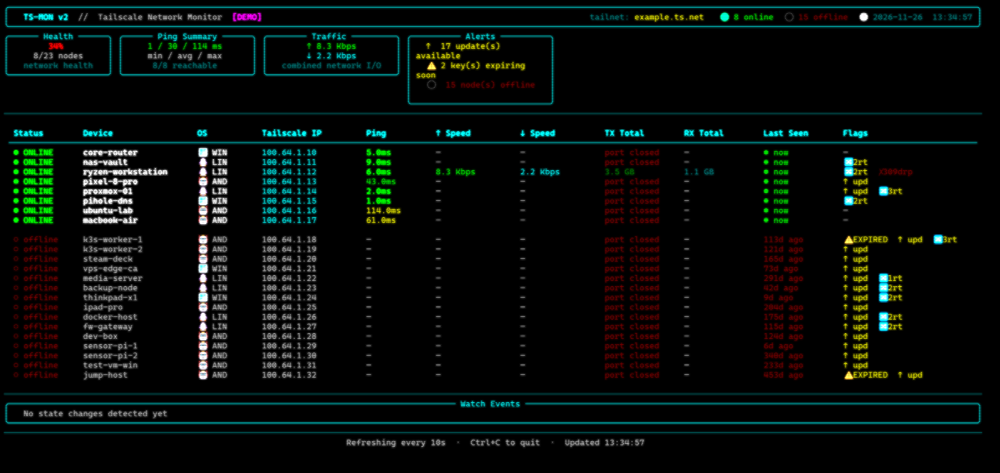

# TS-MON v3 — Tailscale Network Monitor

Copyright (c) 2026 Zachary V. Martin, CC

Real-time terminal dashboard for monitoring Tailscale tailnet nodes, latency (`ping`), live `tx`/`rx` throughput and DERP-vs-direct routing hints via Tailscale's local Prometheus `/metrics` endpoint (`:5252`), and live online/offline state changes using `rich`.

<!-- Uncomment once docs/screenshot-demo.png is uploaded to the repository:

-->

## Features
- **Live Node Overview:** Real-time online/offline status, OS icons, Tailscale `100.x` IPv4 addresses, and last-seen timestamps.
- **Concurrent Ping Sweeps:** Multi-threaded ICMP latency checks with color-coded thresholds (`<20ms`, `<60ms`, `<150ms`, `>150ms`) and min/avg/max summary stats.
- **Live Bandwidth & DERP Telemetry (`:5252`):** Polls Tailscale's local `/metrics` endpoint for real-time `↑`/`↓` speeds, cumulative `TX`/`RX` byte totals, packet drop counters (`✗ drp`), and `(D)` badges when >10% of traffic routes via DERP relay instead of direct peer-to-peer.
- **Smart Alerts & Flags:** Tracks available client updates (`↑ upd`), expiring node keys (`⚠ key`, automatically ignoring nodes with key expiry disabled), incoming connection shields (`🛡`), and advertised subnet routes (`🔀 rt`).
- **Watch Events Feed:** Live event log highlighting nodes as they come online or go offline.
- **Demo / Screenshot Mode (`--demo`):** Redacts your tailnet name, hostnames, and Tailscale IPs for safe public screenshots.

## Prerequisites
- **Python 3.9+** (`python3` and `venv` module — on Debian/Ubuntu/Pop!_OS, install `sudo apt install python3-venv python3-pip` if needed)
- **Tailscale API token** with device read access (`tskey-api-...`) and your tailnet identifier
- **Optional:** TCP reachability to port `5252` on target nodes if you want live `/metrics` bandwidth and DERP-vs-direct telemetry

## Quick Setup

### 1. Clone the repository
```bash
git clone https://github.com/ZvMartin/tailscale-network-monitor.git
cd tailscale-network-monitor
```

### 2. Create a virtual environment and install dependencies
```bash
python3 -m venv .venv
source .venv/bin/activate   # Windows PowerShell: .venv\Scripts\Activate.ps1
pip install -r requirements.txt
```

### 3. Configure your credentials
Set environment variables (recommended so secrets stay out of git) **or** edit the fallback block at the top of `tailmon.py`:

**Option A — Environment Variables (Linux / macOS):**
```bash
export TS_API_KEY="tskey-api-YOUR_KEY_HERE"
export TS_TAILNET="example.ts.net"
```

**Option A — Environment Variables (Windows PowerShell):**
```powershell
$env:TS_API_KEY = "tskey-api-YOUR_KEY_HERE"
$env:TS_TAILNET = "example.ts.net"
```

**Option B — In-File Configuration:**
Edit `API_KEY` and `TAILNET` near the top of `tailmon.py` (obtainable from **Tailscale Admin Console → Settings → Keys**).

### 4. Run the monitor
```bash
python3 tailmon.py
```

## Usage Options

```bash
# Standard live monitor
python3 tailmon.py

# Redacted demo mode for clean screenshots
python3 tailmon.py --demo
```

## Enabling Node Metrics (`:5252`)
Nodes without the Tailscale metrics listener enabled will display `port closed` in the `TX Total` column while still reporting API status and ping latency. To expose `/metrics` over your tailnet on a Linux node:

```bash
sudo tailscale set --metrics=100.x.y.z:5252
```
*(Replace `100.x.y.z` with that node's Tailscale IPv4 address so metrics remain accessible only inside your tailnet.)*

## Notes
- Requires read access to the Tailscale API and optional reachability to port `5252` on nodes exposing `/metrics`.
- Designed to integrate cleanly into terminal dashboards (such as `ttyd` + Homepage) or run standalone in any terminal.